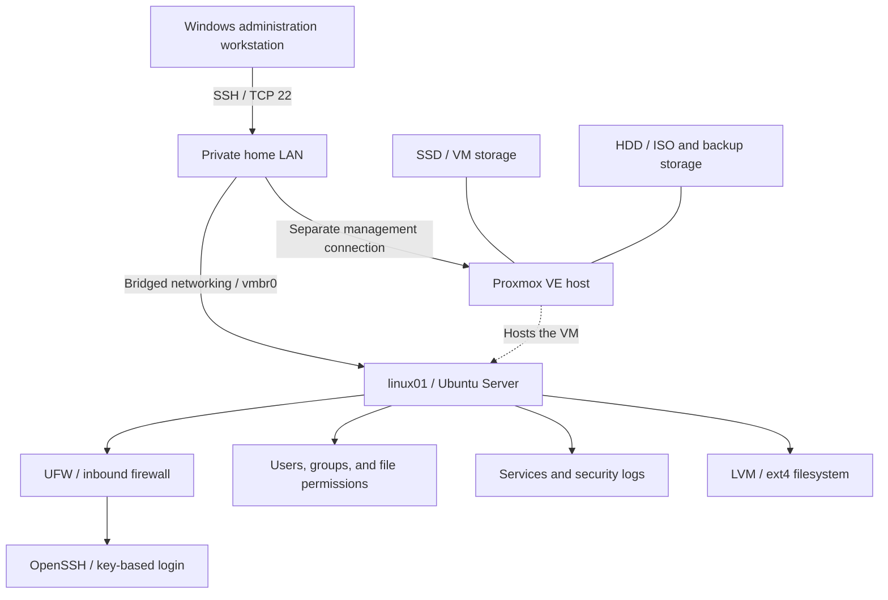

# Linux Server Administration & Security Hardening

**Lab 01 | Proxmox VE | Ubuntu Server | Linux permissions | OpenSSH | UFW | systemd | LVM**

I built and secured an Ubuntu Server virtual machine on my dedicated Proxmox homelab. My goal was to get comfortable managing a real Linux system, understand how its security controls work, and learn how to troubleshoot problems when things don't go as planned.

I didn't want to stop at changing configuration files. For each major security control, I checked what the system was actually doing: who could access a directory, which SSH login methods worked, what traffic the firewall allowed, and whether everything still worked after updates.

**The result:** A working Linux server with tested user permissions, key-based SSH, a default-deny firewall, authentication-log investigation, and documented administration and maintenance work.

## My homelab setup

| Component | What I used |
| --- | --- |
| Physical host | Dedicated HP ProDesk running Proxmox VE |
| Virtual machine | `linux01` — Ubuntu Server 26.04 LTS |
| VM resources | 2 vCPUs, 2 GiB RAM, 32 GiB virtual disk |
| Network | Bridged private LAN (`vmbr0` on Proxmox, `ens18` on Ubuntu) |
| Storage | SSD-backed VM storage; LVM and ext4 inside Ubuntu |
| Administration | Windows PowerShell and OpenSSH; Proxmox console as a backup way in |

### How it fits together



The diagram shows how the lab is connected, not a publicly exposed network. I did not intentionally forward SSH or Proxmox management ports through my home router.


*Figure 1 — The Ubuntu VM running in my Proxmox homelab.*

## What I built and tested

### 1. Made a shared directory accessible only to the right users

I created a `secops` group and a shared folder at `/srv/secops-share`. I wanted Alice and my administrator account to be able to work together without giving everyone on the server access.

The directory uses `root:secops` ownership and permissions of `2770`. The `2` enables **setgid**, which means newly created files inherit the directory's group. I also learned that this doesn't automatically fix the group ownership of files that already exist.

Rather than assume the permissions were correct, I tested them with three accounts:

| Account | Expected access | What happened |
| --- | --- | --- |
| `alice` | Allowed | Could open the directory and create files |
| `richard` | Allowed | Could access the directory and collaborate on files |
| `bob` | Denied | Couldn't list, enter, read from, or create files in the directory |


*Figure 2 — Changed the shared directory from `770` to `2770` to enable group inheritance.*


*Figure 3 — Bob's account was denied access to the protected folder.*

### 2. Secured SSH without locking myself out

SSH is how I normally administer Ubuntu from my Windows computer. I generated a passphrase-protected **Ed25519 SSH key** and configured the server to accept public-key authentication while disabling password-based and root SSH login.

I ran into a problem: an existing cloud-init configuration file was still enabling password authentication. Instead of editing that managed file, I created an earlier-loading SSH configuration file and used `sshd -t` and `sshd -T` to check that the settings were valid and actually took effect.

My final SSH settings included:

```text
PermitRootLogin no
PasswordAuthentication no
PubkeyAuthentication yes
KbdInteractiveAuthentication no
```

Then I tested both outcomes: **the SSH key worked, and password-only login was rejected**. I kept my existing SSH session and the Proxmox console available while making changes.


*Figure 4 — Confirmed the SSH settings the server was actually using.*

| SSH key allowed | Password-only login denied |
| --- | --- |
|  |  |

### 3. Configured a default-deny host firewall

I enabled **UFW** to deny incoming connections by default, while allowing SSH on TCP/22 from my trusted home subnet (`192.168.0.0/24`).

After enabling the firewall, I opened a new SSH connection to make sure I hadn't blocked my own access. I also saw the firewall log blocked IGMP traffic, which was ordinary network activity—not evidence of an attack.


*Figure 5 — UFW active with a subnet-restricted SSH rule.*

I confirmed that authorized LAN SSH worked, but I **did not** independently test an SSH connection being denied from an outside subnet during this lab.

### 4. Investigated a failed SSH login

Before disabling password authentication, I deliberately generated a failed SSH login and investigated the event with `journalctl -u ssh -n 5`.

I could see the account being targeted, the source address, the timestamp, the failed authentication, and the connection ending. This was my introduction to looking at Linux logs as security evidence rather than just error messages.


*Figure 6 — A controlled failed login recorded in Ubuntu's SSH journal.*

### 5. Expanded the server's storage

I used `lsblk`, `pvs`, `vgs`, `lvs`, and `df -h` to understand how Ubuntu's virtual disk, logical volume, and filesystem fit together.

The root filesystem started at about **15 GiB**. My plan was to add 5 GiB, but I accidentally ran the relative LVM expansion command twice. That left a **25 GiB logical volume** while the filesystem was still at its original size.

Instead of trying to shrink a live root volume, I checked the actual storage layout and used `resize2fs` to expand ext4 to match. The root filesystem ended up at about **25 GiB**, with around **5 GiB still free in the volume group**.

| Before: 15 GiB root filesystem | After: 25 GiB root filesystem |
| --- | --- |
|  |  |

This mistake taught me why it's important to verify the system's current state before attempting another change.

### 6. Managed services, updates, and recovery checkpoints

I used `systemctl`, `journalctl`, `pgrep`, and `chronyc` to inspect services and investigate their logs. I deliberately stopped and restarted Chrony to understand how a service behaves, including the difference between **enabled** and **running**.

I also reviewed and installed system updates. Before the kernel upgrade, I created a temporary Proxmox snapshot as a rollback checkpoint. After upgrading and rebooting, I checked that:

- The running kernel was `7.0.0-38-generic`.
- There were **zero failed systemd units**.
- SSH and Chrony were running.
- UFW and the SSH security settings were still in place.
- The root filesystem was still about **25 GiB**.


*Figure 7 — Verified the server and its security settings after the kernel update.*

At that checkpoint, five Ubuntu updates were still deferred by phased rollout, so I'm **not claiming the server was fully patched**.

## Problems I ran into

Three challenges stood out:

| Problem | What I learned or changed |
| --- | --- |
| My new `secops` membership didn't work in the current SSH session | Group changes aren't always reflected in an already-open session. Logging in again fixed it. |
| SSH wasn't using the password setting I expected | I checked which configuration file took precedence, fixed the override, and tested the effective settings. |
| I extended the logical volume farther than planned | I checked the logical volume and filesystem separately, avoided a risky shrink, and completed the filesystem expansion safely. |

I documented the commands, investigation, and fixes in [my troubleshooting notes](docs/troubleshooting.md).

## What I learned

My biggest takeaway is that **configuring a server is only half the job**. I also need to understand why something works, test whether it behaves the way I expect, and know how to investigate when it doesn't.

The storage mistake was a particularly useful lesson. Making another change immediately might have made things worse. Checking the actual system state first gave me a safer way forward.

## What this lab does and doesn't cover

This is an educational homelab, not a production deployment or a formal security-compliance assessment. I verified specific user permissions, SSH authentication behavior, authorized LAN SSH, service health, and post-update settings. I did **not** independently test every possible firewall path, complete an IPv6 denial test, or perform full vulnerability or compliance scanning.

The Proxmox snapshot was a temporary recovery checkpoint, **not a replacement for backups**. I also did not deploy a SIEM, EDR, or enterprise identity platform as part of this lab.

## Documentation

- [Implementation and commands](docs/implementation.md)
- [Security controls and test boundaries](docs/security-controls.md)
- [Troubleshooting notes](docs/troubleshooting.md)
- [Screenshot and privacy notes](docs/evidence-manifest.md)
- [Example SSH configuration](configs/01-homelab-hardening.conf)

**Privacy:** The published screenshots are sanitized copies. I kept my original screenshots private and removed unnecessary identifying information from the public versions. Sanitization reduces exposure, but it doesn't eliminate every security risk.

## Continuing the homelab

**[Lab 01.5 — Secure Remote Access with Tailscale](https://github.com/KingRichardVII/tailscale-secure-remote-access)** builds directly on this server. I added manual device approval, limited Tailscale access to SSH, and successfully connected from my laptop using a cellular hotspot without opening a public SSH port.

My next major project is **Splunk SIEM and Linux Security Monitoring**, where I'll start collecting and investigating security events centrally.
