# Linux Server Administration & Security Hardening

**Lab 01 · Proxmox VE · Ubuntu Server 26.04 LTS · Linux access control · OpenSSH · UFW · systemd · journalctl · LVM**

I built and secured an Ubuntu Server virtual machine using Proxmox VE. The goal was to create a Linux environment where I could practice real-world system administration, implement security controls, troubleshoot issues, and verify that my configurations worked as intended.

## Objective

Build a reusable Linux infrastructure foundation for a small enterprise-style security homelab, while demonstrating *configuration, verification, troubleshooting, and change management* rather than only successful installation.

## Architecture

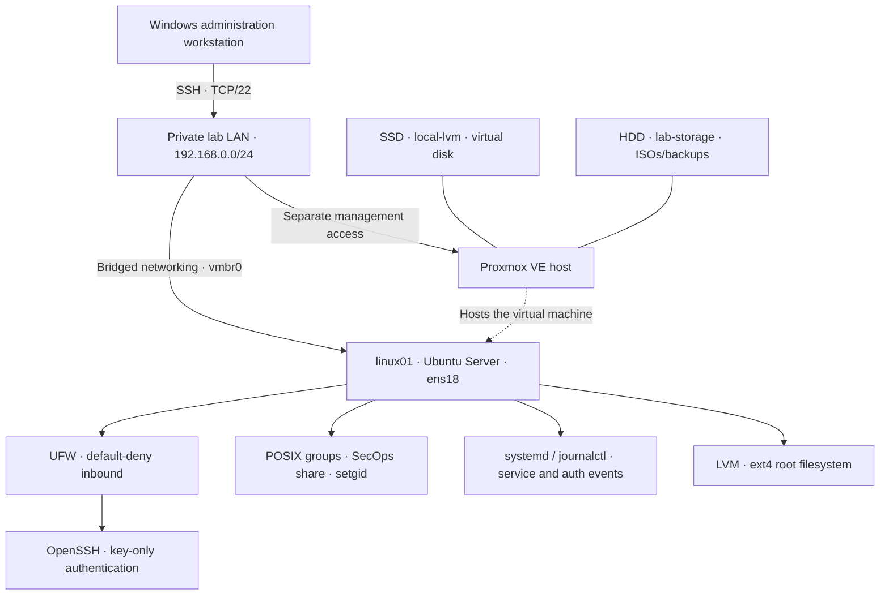

This diagram shows the lab's logical relationships, not public Internet exposure. Only the private subnet is shown; exact host addresses are redacted from published screenshots; **no Proxmox management or SSH ports were intentionally forwarded to the public Internet**.

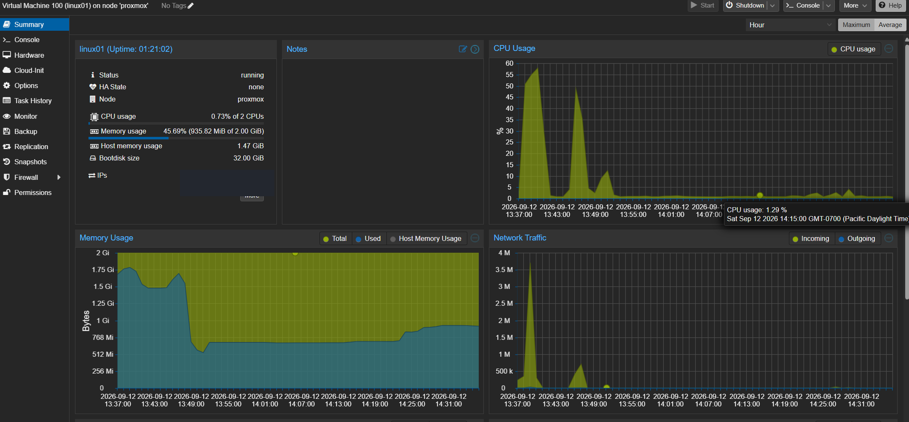
*Figure 1 — Proxmox VM dashboard showing the running Ubuntu server and its allocated resources.*

## Environment

| Component | Implementation |
| --- | --- |
| Hypervisor | Proxmox VE on dedicated HP ProDesk hardware |
| Guest | Ubuntu Server 26.04 LTS (`linux01`), 2 vCPU, 2 GiB RAM, 32 GiB virtual disk |
| Storage | Proxmox SSD-backed VM storage; ext4 root filesystem on LVM within the guest |
| Network | Bridged VM NIC (`ens18`), private home subnet |
| Administration | Windows PowerShell / OpenSSH client; Proxmox console retained as recovery path |
| Security | Linux users/groups, setgid, UFW, key-based SSH, systemd journal |

## Security controls and validation

Security controls were implemented using Linux-native administration tools and validated through controlled testing. I didn't want to assume a security control was working just because the configuration looked correct. I tested both successful and denied access, reviewed system logs, checked running services, and verified that the controls still worked after making changes.

The implementation focused on three primary security objectives: **least-privilege access to shared resources**, **key-based remote administration**, and **default-deny inbound network traffic**.

### 1. Group-based authorization and least privilege

Created an authorized `secops` group and a shared workspace at `/srv/secops-share`, owned by `root:secops`. Configured mode `2770` so group members can collaborate while other users are denied traversal. The setgid directory bit makes **new files inherit the directory's group**; pre-existing files required separate `chgrp` correction.

Validated the policy using three separate identities rather than relying only on ownership and mode bits:

| Test identity | `secops` member? | Observed result |
| --- | --- | --- |
| `alice` | Yes | Access and file creation permitted |
| `richard` | Yes | Access and cross-user file edits permitted |
| `bob` | No | Directory listing, traversal, reading, and file creation denied |

When `richard` was first added to `secops`, an existing SSH session retained its old group credentials. A new login refreshed the supplementary groups and resolved the authorization mismatch; see [Troubleshooting](docs/troubleshooting.md).

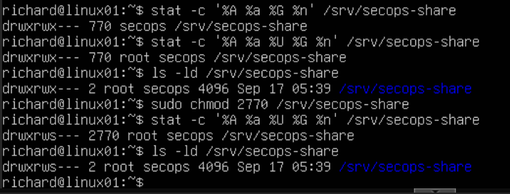
*Figure 2 — Directory permissions changed from 770 to 2770 (`drwxrws---`).*

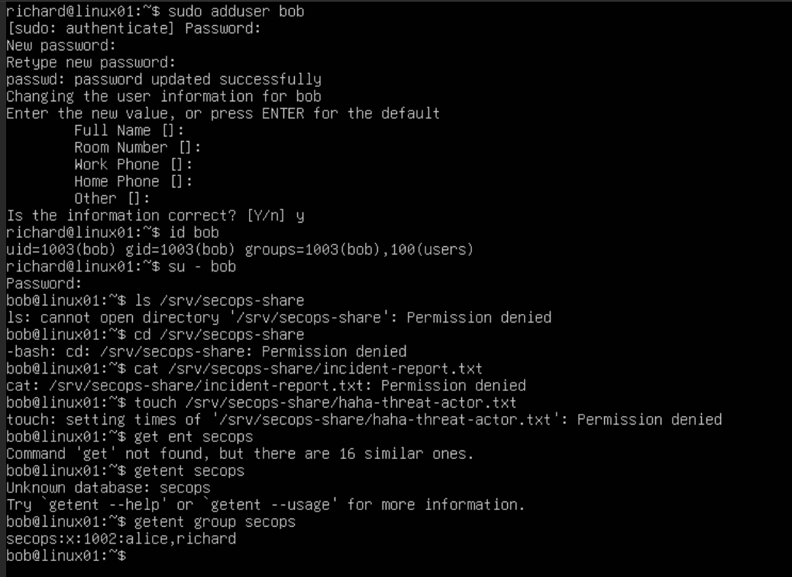
*Figure 3 — Unauthorized account denied access to SecOps resources.*

### 2. SSH authentication hardening

Established a passphrase-protected Ed25519 SSH key pair on the Windows client and installed the public key into `richard`'s `authorized_keys`. Inspection found that `/etc/ssh/sshd_config.d/50-cloud-init.conf` explicitly set `PasswordAuthentication yes`. To avoid modifying the managed file directly, created an earlier-loading `01-homelab-hardening.conf` and verified that its settings took effect using `sshd -T`.

Effective policy: `PermitRootLogin no`, `PasswordAuthentication no`, `PubkeyAuthentication yes`, `KbdInteractiveAuthentication no`.

Validation tested **both sides of the authentication policy**, not just its syntax: after `sshd -t` succeeded and the service was reloaded, a new Ed25519 public-key-only connection succeeded, while a separate password-only connection returned `Permission denied (publickey)` without prompting for the account password.

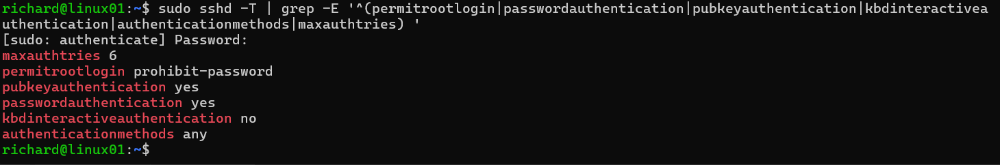
*Figure 4 — `sshd -T` effective settings after configuration validation.*

| Allowed authentication | Denied authentication |
| --- | --- |
| 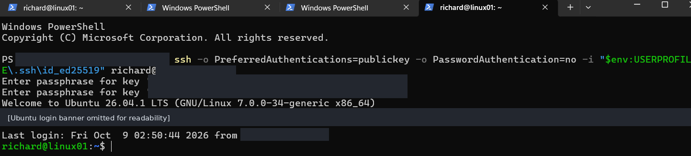 | 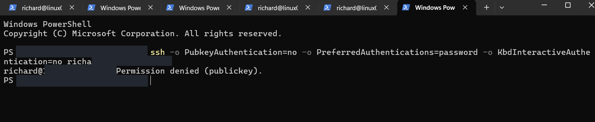 |
| **Public key: ALLOW** | **Password only: DENY** |

**Safety:** Existing SSH session and hypervisor console remained available during changes. `sshd -t` passed before a service reload. Public and private SSH keys are **not included** in this repository.

### 3. Host firewall

Enabled UFW with **deny incoming / allow outgoing** and an explicit allow rule for SSH TCP/22 originating from `192.168.0.0/24`. Verified an authorized *new* SSH connection from that subnet could succeed after activating UFW. Also observed logged blocks of multicast/IGMP packets, providing evidence that the firewall blocked some traffic; those events are **not evidence of malicious activity**.

**Validation boundary:** The exercise did **not** include a controlled denied SSH connection from outside the permitted subnet. The policy was inspected and permitted access was tested, but broader TCP denial must not be described as independently tested.

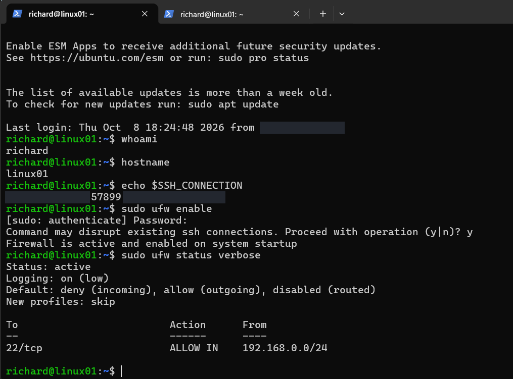
*Figure 5 — UFW activated with an IPv4 subnet-scoped SSH exception.*

See [Security controls and limitations](docs/security-controls.md) for IPv6 and remote-access considerations.

### 4. SSH authentication log investigation

Generated a **controlled failed SSH password attempt before switching to key-only authentication**. Queried the systemd journal and extracted the timestamp, targeted account, source IP (masked in the published image), source port, authentication result, and connection-reset event. The logs show observable authentication events; they do not independently establish the operator's identity or intent.

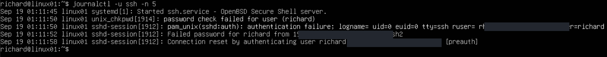
*Figure 6 — Investigated a deliberately generated failed SSH authentication event with `journalctl -u ssh -n 5`.*

### 5. Storage expansion

Investigated the guest storage hierarchy: virtual disk → partition `/dev/sda3` → LVM physical volume → volume group `ubuntu-vg` → logical volume `ubuntu-lv` → ext4 mounted at `/`.

The root filesystem was increased from **15G to 25G** online, with **5G remaining free in the volume group**. Logical-volume growth and ext4 filesystem growth were verified separately.

| Before: root 15G, VG free ~15G | After: root 25G, VG free ~5G |
| --- | --- |
| 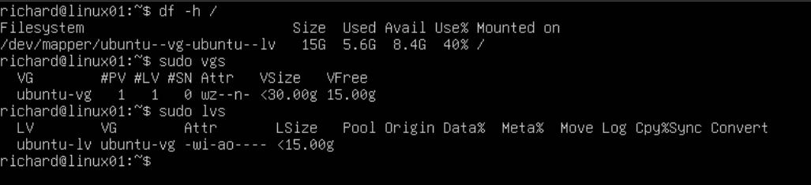 | 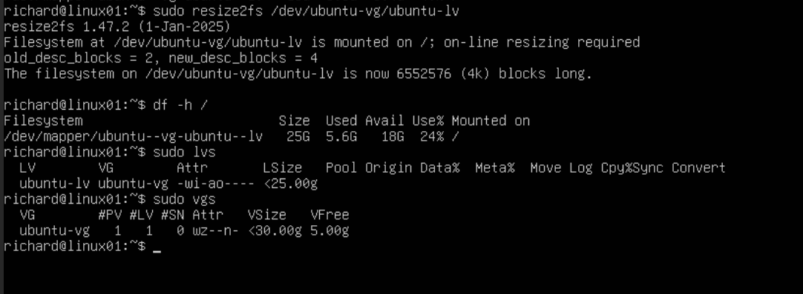 |

The initial plan was to grow by 5G, but the relative `+5G` extension was accidentally executed twice. Instead of a risky reduction on a live root LV, the enlarged allocation was retained and ext4 was expanded to match. The incident is documented in [Troubleshooting](docs/troubleshooting.md).

### 6. Service administration and recovery

Inspected and managed `chrony.service` via `systemctl` and `pgrep`, reviewed its lifecycle with `journalctl -u chrony`, restored it after a controlled stop, and checked NTP tracking with `chronyc tracking`. Distinguished **enabled versus active** and **administrative shutdown versus service failure**.

### 7. Patch management and post-change validation

Refreshed APT metadata, reviewed upgrades, simulated upgrade transactions, and performed package maintenance. When kernel metapackages required additional dependencies, simulated `apt-get --with-new-pkgs upgrade`, established a short-lived Proxmox snapshot checkpoint, installed kernel version `7.0.0-38-generic`, then rebooted.

Post-reboot tests confirmed:

- `uname -r` reported `7.0.0-38-generic`.
- `systemctl --failed` reported **zero failed units**.
- SSH and chrony were active.
- UFW was active with the intended SSH subnet exception.
- Effective SSH settings remained hardened.
- Root filesystem remained approximately **25G**.

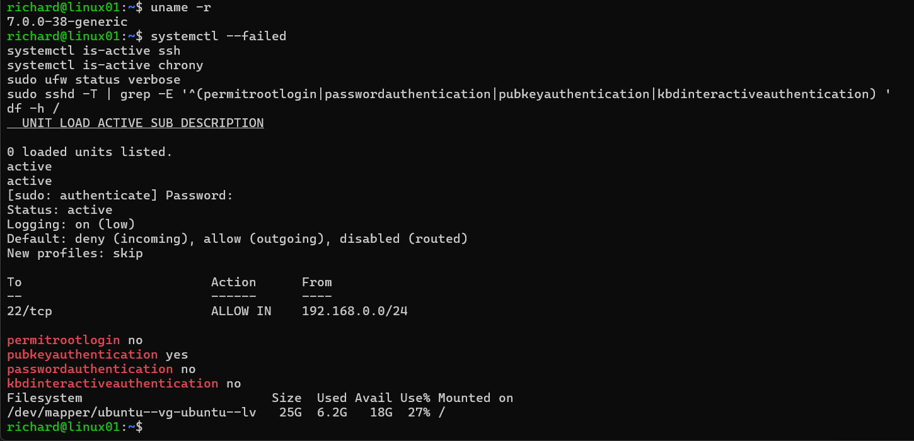
*Figure 7 — Kernel and key security controls independently verified after reboot.*

**Update limitation:** Five packages were still deferred by Ubuntu's phased-update mechanism during the recorded patching session. The report does **not** claim the system had zero outstanding updates.

## Troubleshooting highlights

I encountered three issues that required troubleshooting. Instead of immediately changing settings, I used Linux tools to investigate what was happening and determine the safest way to resolve each problem.

| Challenge | Evidence and diagnosis | Resolution |
| --- | --- | --- |
| **New `secops` membership did not grant access in an existing session** | `getent group secops` listed `richard`, but `id` in the current SSH session did not; directory access was denied. | Started a fresh login session, verified updated supplementary groups, and successfully accessed the protected directory. |
| **SSH settings conflicted with a cloud-init drop-in** | `/etc/ssh/sshd_config.d/50-cloud-init.conf` explicitly enabled password authentication. The effective server configuration, rather than file contents alone, was the source of truth. | Created an earlier-loading `01-homelab-hardening.conf`, validated it with `sshd -t` and `sshd -T`, reloaded SSH, and tested key-only ALLOW versus password-only DENY. |
| **Root LV was extended farther than planned** | A relative `lvextend -L +5G` operation was issued twice. `lvs`, `vgs`, and `df -h /` showed a ~25G logical volume while ext4 still occupied ~15G. | Avoided an unnecessary live-root volume reduction; grew ext4 online with `resize2fs`, verified a ~25G root filesystem, and retained ~5G unallocated in the VG. |

See the [full troubleshooting notes](docs/troubleshooting.md) for the command-level context, plus the controlled chrony lifecycle and kernel-log triage exercises.

## Lessons learned

My biggest takeaway from this lab is that configuring a system is only half the job. You also need to understand why a configuration works, test whether it behaves as expected, and know how to troubleshoot it when something goes wrong.
I also learned that the safest solution isn't always to make another change. When I accidentally extended the root logical volume farther than planned, I investigated the storage layout before deciding how to proceed. That experience reinforced the importance of verifying system state and understanding the risks before making changes.

## Scope and limitations

- **Educational environment:** This is a homelab, not a production deployment, a complete CIS/NIST compliance assessment, or evidence of production operations.
- **Firewall tests:** Authorized LAN SSH connectivity and actual IGMP packet blocks were observed. A controlled denied-SSH test from outside `192.168.0.0/24`, including an independent IPv6 negative test, was **not** performed. The LAN-wide allowance is not per-device authorization.
- **Pending packages:** Five upgrades remained deferred by Ubuntu's phased-update mechanism at the recorded patching checkpoint; the system is **not** claimed to be fully patched.
- **Recovery:** The pre-kernel-upgrade Proxmox snapshot was a temporary rollback checkpoint, **not** a complete or independently tested backup strategy.
- **Troubleshooting scope:** Chrony was intentionally stopped and restored in a controlled service-lifecycle exercise; this was **not** an unexpected production outage. The KHO message had no demonstrated operational impact and was not "fixed" without evidence.
- **Technology scope:** SIEM, EDR, Entra ID, Proofpoint, and vulnerability-scanning tools were **not deployed as part of Lab 01**.

## Next steps

1. Secure remote access via a VPN overlay (Tailscale), without exposing management ports publicly.
2. Splunk Enterprise: centrally collect and investigate Linux authentication/system events.
3. Email security: headers, SPF, DKIM, DMARC, and Proofpoint-informed InfoSec workflows.
4. Continue segmented networking, AD/Entra ID, endpoint telemetry, and vulnerability-management labs in the same infrastructure.

## Supporting documentation

- [Implementation notes](docs/implementation.md)
- [Security controls and limitations](docs/security-controls.md)
- [Troubleshooting and lessons](docs/troubleshooting.md)
- [Screenshot provenance and publishing checklist](docs/evidence-manifest.md)
- [Sanitized SSH hardening example](configs/01-homelab-hardening.conf)

### Related Projects

**[Lab 01.5 — Secure Remote Access with Tailscale](https://github.com/KingRichardVII/tailscale-secure-remote-access)**

Extended this Linux environment with secure remote access using Tailscale. Configured manual device approval, a least-privilege SSH access policy, and separate SSH keys for my laptop. Validated remote administration from an external network without router port forwarding.

**Privacy:** Published screenshots were reviewed and sanitized to reduce unnecessary exposure of personal and network information. Original screenshots are retained privately. Sanitization reduces information exposure but does not eliminate every security risk.
